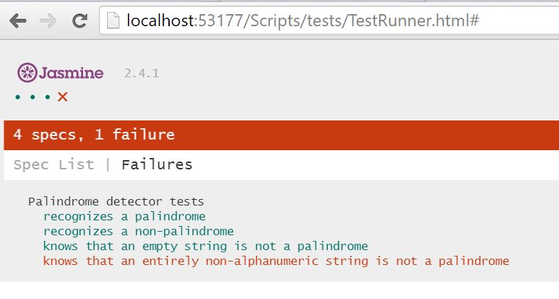

I’m a proponent of unit testing, but I’ve never written a single test for JavaScript, ever. This is my personal “Hello, world” introduction to JavaScript unit testing. The testing framework is [Jasmine](http://jasmine.github.io/). If you haven’t used it yourself then perhaps the perspective of another absolute beginner will be helpful.

Are you ever a tiny bit frustrated when you look for an introductory example and it isn’t quite introductory? (I’m not ashamed to admit it. I got over that a while ago.) Sometimes I Google ‘[Whatever I’m trying to learn] simple example’ hoping that there _is_ a simple example. That’s why this is titled “Simple Example.”

## Something to Test

This is `PalindromeDetector.js`. It returns `true` if the input string is a palindrome, `false` otherwise.

``` js
        (function() {
            window.PalindromeDetector = function() {
                this.isPalindrome = function(text) {
                    if (!text) return false;
                    var characters = text.toLowerCase().split('').filter(function (character) {
                        return character.match(/^[0-9a-z]+$/);
                    });
                    if (characters.length === 0) return false;
                    var forward = characters.join();
                    characters.reverse();
                    var backward = characters.join();
                    return forward === backward;
                }
            }
        })();
```

I created an empty website (using Visual Studio) and added the [jasmine Nuget package](https://www.nuget.org/packages/jasmine/2.4.1).

It took a bit of experimenting to figure out what to do next. I looked at Jasmine’s documentation (meaning what’s on the [home page](http://jasmine.github.io/)). From there I understood what the code for a few unit tests would look like, but no idea how I might actually run them or what the output was supposed to look like. Do my tests output something to the console? Not a clue.

I’ll skip past the trial and error to what worked.

## The Tests

This is another JavaScript file containing the tests. It’s called `PalindromeDetectorTests.js`.

``` js
        describe("Palindrome detector tests", function () {
            var detector;

            beforeEach(function () {
                detector = new PalindromeDetector();
            });

            it("recognizes a palindrome", function () {
                expect(detector.isPalindrome("Madam, I'm Adam.")).toBe(true);
            });
            it("recognizes a non-palindrome", function () {
                expect(detector.isPalindrome("Hello")).toBe(false);
            });
            it("knows that an empty string is not a palindrome", function () {
                expect(detector.isPalindrome("")).toBe(false);
            });
            it("knows that an entirely non-alphanumeric string is not a palindrome", function () {
                expect(detector.isPalindrome("!@# #@!")).toBe(true);
            });
        });
```

## What Runs the Tests?

This file, which brings it all together, is `TestRunner.html`:

``` js
        <html>
        <head>
            <title>Palindrome Detector Tests</title>
            <link rel="stylesheet" type="text/css" href="../../Content/jasmine/jasmine.css" />
        </head>
        <body>
            <script src="../jasmine/jasmine.js"></script>
            <script src="../jasmine/jasmine-html.js"></script>
            <script src="../jasmine/boot.js"></script>
            <script src="../PalindromeDetector.js"></script>
            <script src="PalindromeDetectorTests.js"></script>
        </body>
        </html>
```

Nothing but scripts. And when I view the page in the browser, it executes the tests and displays the results. The last one is red because I deliberately wrote it to fail.



I can click on `Failures` and get details about the failed test. The options in the upper-right corner allow me to specify whether to raise exceptions, whether to continue if a test fails, and allows me to run them in random order. (They didn’t make it into the screenshot, but really, there are more options in the upper-right corner.)

This is just a start, but it’s been under my skin that I never unit test my JavaScript. Now I can write tests.